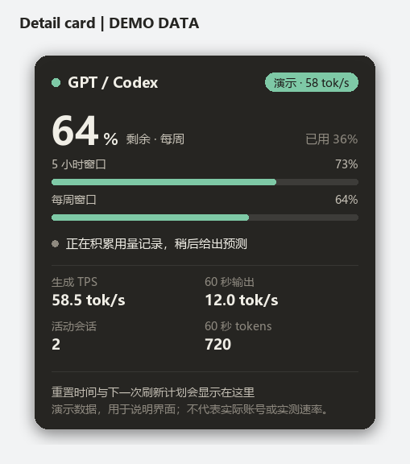

# CodexQuotaTray · AI 额度与 TPS 托盘

面向 Windows 的独立托盘工具，将本机 AI 客户端的账号额度、生成速率、重置时间和用量趋势放到通知区域。启动时先显示缓存，再在后台读取各来源；鼠标悬停后展开置顶详情卡片。

A Windows system-tray monitor for local AI quota and token-usage signals, with generation-rate indicators, reset countdowns and topmost detail cards.

[MIT 许可证](LICENSE) · [快速开始](#安装与启动) · [数据源](#数据源与支持范围) · [配置](#配置) · [构建](#构建-exe) · [自检](#自检与排错)

## 功能概览

- **独立来源图标**：默认显示 Codex、Grok、Gemini，Claude Code 为可选来源。
- **额度圆环**：外圈表示剩余百分比。存在两个额度窗口时，按剩余更少的窗口绘制图标，卡片分别展示各窗口。
- **生成速率显示**：取得可核验样本且来源处于活动状态时，圆盘点亮并显示最近样本；缺少样本时继续显示额度。
- **自绘详情卡片**：展示额度、TPS、60 秒输出速率、活动会话、重置倒计时、预测与刷新计划。窗口置顶、鼠标穿透，并保持键盘焦点。
- **按需刷新**：根据空闲、活动、生成结束、读取失败和重置时间调度额度查询。
- **额度耗尽预测**：从本程序积累的数值历史估计消耗趋势，样本不足时明确提示。
- **缓存与诊断**：失败时保留最后有效数值并标记旧数据，运行日志自动轮转。

### 图标与卡片示例

以下图片由项目自身的绘制代码生成，使用演示数据，不代表真实账号额度、实测速率或当前运行状态。图标依次展示 C、G、M、A；A 为可选的 Claude Code 来源。




## 数据源与支持范围

| 图标 | 来源 | 额度读取方式 | 生成速率与输出计数 | 当前边界 |
| --- | --- | --- | --- | --- |
| C | GPT / Codex | 本机 Codex App Server 的 `account/rateLimits/read` | 本地会话的真实输出 token 计数，以及关联的客户端流式时间 | 按账号响应展示一个或两个额度窗口；统计依赖本地日志格式 |
| G | Grok CLI | 临时 CLI 会话执行 `/usage`，解析 `Weekly limit` 与重置时间 | 直接读取客户端原生 `tokens_per_sec` 和输出计数 | 需要对应 CLI 已安装、已登录；终端输出格式变化会影响解析 |
| M | Gemini / Antigravity | `agy --print /usage --output-format json`，读取 `gemini-5h` 桶 | 读取 Antigravity 桌面端或 CLI 本地记录中的输出计数 | 当前读取器没有取得可核验的原生生成 TPS；`agy` 不能直接替换成任意名为 Gemini 的 CLI |
| A | Claude Code，可选 | 临时 Claude Code 会话执行 `/usage`，解析当前会话与每周订阅窗口 | 读取本地会话的 `message.usage.output_tokens` | 解析、去重与错误路径已有测试；真实订阅账号额度尚缺端到端验收；免费桌面端额度未接入 |

额度、输出计数和生成速率来自不同信号。能读到额度，不代表同一来源也提供生成 TPS；没有近期记录也不能证明没有使用。

### Claude Code 与 Claude 桌面端

A 来源面向 **Claude Code 的 CLI 和本地会话记录**。Claude 桌面应用的安装状态、免费版聊天额度和桌面端对话记录不通过这条接口读取。

若你使用 Claude 免费桌面端，可先配置 `codex,grok,gemini`。启用 A 时，应准备能正常执行 `/usage` 的 Claude Code 登录环境。API Key 计费环境没有这类订阅额度窗口，程序会报告未知或读取失败。

未显式指定来源时，Claude 会在检测到 CLI 或 Claude Code 项目记录目录后自动加入，否则保持关闭。只存在记录目录而缺少可执行文件时，额度仍可能显示未知。显式设置 `CODEX_QUOTA_PROVIDERS` 可以固定显示范围。

## 安装与启动

### 运行环境

- Windows 10/11 的交互式桌面，推荐 64 位 Python 3.12。
- 本机验收环境为 Windows 11、Python 3.12.10。Windows 10 尚缺本项目的实机验收记录。
- 对应来源的客户端及登录状态。可先只启用已准备好的来源。

托盘界面依赖 Win32 与 Windows 通知区域。Linux 上可运行部分纯逻辑模块，完整托盘程序的运行目标是 Windows。

### 从源码运行

```powershell
git clone https://github.com/ANTiqiuSama/CodexQuotaTray.git
Set-Location CodexQuotaTray
python -m venv .venv
.\.venv\Scripts\python.exe -m pip install -r requirements.txt

# 固定显示来源，也适合只使用 Claude 免费桌面端的情况。
$env:CODEX_QUOTA_PROVIDERS = 'codex,grok,gemini'
.\.venv\Scripts\python.exe -X utf8 tray_app.py
```

仓库提供源码与构建入口。自行构建的程序位于指定输出目录，可直接运行 `CodexQuotaTray.exe`。正常托盘实例使用单实例锁，重复启动不会增加一套图标。

### 日常操作

| 操作或状态 | 行为 |
| --- | --- |
| 鼠标在图标上短暂停留 | 展开该来源的详情卡片 |
| 移开鼠标 | 关闭详情，图标恢复最新数值 |
| 左键点击图标 | 打开对应桌面程序或 CLI |
| 右键 → 立即刷新 | 请求所有已显示来源刷新额度 |
| 右键 → 额度详情 | 显示文字详情与预测 |
| 右键 → 本机全部 AI 速率 | 查看各来源输出速率及软件检测结果 |
| 右键 → 打开诊断信息 | 生成并打开本地诊断文件 |
| 右键 → 开机自启 | 切换当前程序的 Windows 登录启动项 |
| 右键 → 退出全部 | 退出所有来源图标 |

空闲时是深色圆盘与字母，生成时是来源主色的亮圆盘与 TPS 数字。字母、数字优先使用 Sitka Small Bold，并回退到 Cambria、Palatino、Georgia 等系统字体。低于 50% 为琥珀色，低于 20% 为玫瑰红；未知值显示 `?`，旧数据增加琥珀色圆点。

悬停期间暂缓重绘对应托盘图标，卡片内容继续更新，移开后再补上图标数值。卡片失败时回退为原生文字提示。

## 指标如何计算

### 生成 TPS

**Grok** 直接采用客户端提供的原生 TPS 数值。

**Codex** 从本地日志复算最近完成请求的生成速率：

```text
生成 TPS = 真实输出 token 数 / 首个输出项至计数完成的流式时间
```

输出计数可包含思考及工具调用输出。它按完成时取得的计数结算，不使用字符长度、近似分词器或请求整体耗时代替。该值属于最近完成的样本，不是逐 token 更新的服务端瞬时速度。样本超过 5 分钟后失效；缺少完整样本时保留额度显示。一次生成结束后，活动状态约保留 3 秒。

**Gemini / Antigravity 和 Claude Code** 当前没有可核验的原生生成 TPS，界面保留未知值，只展示可读到的输出计数和活动状态。

### 最近 60 秒输出速率

```text
60 秒输出速率 = 窗口内已报告的输出 token 总数 / 60
```

这是窗口平均吞吐，不能直接当作单个请求的生成 TPS。统计不计输入和缓存 token，也不重复加入已包含在输出总数中的思考 token。

同一 Claude Code 消息的分块记录按消息 ID 合并计数，完成、出现后续消息或静默达到阈值后结算。现有 Codex Gemini 桥接路径做一对一去重。未知模型可能归入“其他模型”，不保证每种第三方桥接记录都能自动识别。

TPS 观察器每秒读取已有本地信号，本身不发送模型生成请求。额度查询会启动对应 CLI 或 App Server，并由客户端处理网络访问和登录状态。

## 刷新与缓存

额度查询由 `refresh_scheduler.py` 调度，TPS 观察独立运行。

| 触发条件 | Codex / Gemini | Grok / Claude Code |
| --- | --- | --- |
| 启动、手动刷新、检测到唤醒时钟跳变 | 尽快刷新 | 尽快刷新 |
| 空闲 | 15 分钟 | 30 分钟 |
| 持续活动 | 3 分钟 | 10 分钟 |
| 一次生成结束 | 8 秒后 | 20 秒后 |
| 读取失败 | 30 秒、1 分钟、2 分钟、5 分钟退避 | 同左 |
| 已知额度重置时间 | 重置后约 5 秒安排刷新 | 同左 |

调度按来源管理，同一轮到期的读取并行执行。CLI 启动、网络和已有读取任务会影响实际完成时间。卡片底部显示下一次计划刷新。

查询失败时继续显示最后有效数值，同时保留原更新时间并标记“旧数据”。`performance.json` 只在内容变化或距上次保存达到 60 秒时写入；文件时间没有逐秒变化，并不直接意味着观察器停止。

## 额度耗尽预测

每次成功刷新后，程序记录时间、已用百分比与重置时间。它优先选择当前重置窗口内最近 3 小时的样本；近期样本不足时回退到该窗口的完整历史。至少需要两个读数，且时间跨度达到 10 分钟。

程序对已用百分比与时间做最小二乘直线拟合，估计每小时消耗的额度百分点：

```text
预计耗尽所需秒数 = 剩余百分比 / 每小时消耗百分点 × 3600
```

例如，若示例账号一小时内从已用 20% 升到 30%，线性估计为每小时消耗 10 个百分点。剩余 70% 对应约 7 小时。这只是说明计算方式的假设数据。

当预计耗尽时间早于重置，卡片提示约多久后用完；足以覆盖到重置时提示预计剩余量。额度回升或重置窗口变化时，旧窗口样本被截断或排除。历史按窗口最多保留 400 个样本，清理超过 8 天的记录。

预测依赖近期使用节奏、离散的百分比读数和客户端提供的窗口信息。样本不足时不生成耗尽估计；它不能预见后续使用强度或服务端规则变化。

## 配置

### 选择来源

只对当前 PowerShell 会话设置：

```powershell
$env:CODEX_QUOTA_PROVIDERS = 'codex,grok,gemini'
```

保存为当前 Windows 用户的设置：

```powershell
[Environment]::SetEnvironmentVariable('CODEX_QUOTA_PROVIDERS', 'codex,grok,gemini', 'User')
```

环境变量在程序启动时读取。退出旧托盘后，从包含新变量的终端或登录环境重新启动。恢复自动检测时，清除 `CODEX_QUOTA_PROVIDERS`；未设置该变量时，默认 C/G/M，并按检测结果加入 Claude Code。

### 配置项对照

| 变量 | 用途 |
| --- | --- |
| `CODEX_QUOTA_PROVIDERS` | 显示的来源键，支持 `codex,grok,gemini,claude`；按注册表顺序显示 |
| `CODEX_QUOTA_CODEX_EXE` | 用于额度查询的 `codex` App Server 可执行文件路径 |
| `CODEX_QUOTA_GROK_EXE` | 用于额度查询的 Grok CLI 路径 |
| `CODEX_QUOTA_GEMINI_EXE` | 提供对应 `/usage` JSON 的 `agy` 可执行文件路径 |
| `CODEX_QUOTA_CLAUDE_EXE` | Claude Code 的 `.exe` 或 npm `.cmd` 入口路径 |
| `CODEX_HOME` | Codex 本地日志与会话数据根目录 |
| `GROK_HOME` | Grok 本地记录根目录 |
| `CLAUDE_CONFIG_DIR` | Claude Code 数据根目录，默认 `~/.claude` |
| `CODEX_QUOTA_LEGACY_DPI=1` | 关闭悬停线程的 Per-Monitor V2 模式，供旧显示环境排错 |

路径应指向实际安装位置，例如：

```powershell
$env:CODEX_QUOTA_CLAUDE_EXE = 'C:\Tools\ClaudeCode\claude.cmd'
$env:CODEX_QUOTA_PROVIDERS = 'codex,grok,gemini,claude'
```

读取器路径覆盖与左键启动入口是两项设置。左键启动方式由 `providers.py` 中的 `ProviderSpec.launch` 决定；安装方式不同时，需要调整对应入口。

Claude 额度探测在本程序的 `claude-probe` 文件夹中执行，仅发送 `/usage` 状态指令，并使用 `--strict-mcp-config`。首次出现该文件夹的信任提示时，读取器会自动确认。CLI 仍可能使用或更新其自身的偏好、信任和会话文件；这不是对任意工作目录的通用授权。

## 本地数据与隐私

程序自身的数据目录为 `%LOCALAPPDATA%\CodexQuotaTray`：

| 文件或目录 | 内容 |
| --- | --- |
| `state.json` | 最后一次额度读数、时间、旧数据标记和错误状态 |
| `performance.json` | 数值化输出计数、速率、来源及可观测状态 |
| `history.json` | 预测用的时间、已用百分比、重置时间 |
| `app.log` | 运行错误日志，达到约 1 MB 后轮转，保留两份备份 |
| `diagnostics.txt` | 从菜单生成的诊断信息 |
| `claude-probe/` | Claude Code 临时额度探测的工作目录 |

TPS 读取器会在内存解析本地会话记录。`performance.json` 保存数值投影、模型名等统计字段，不包含已解析的消息正文。程序不直接打开客户端的 `auth.json` 或提取 token、cookie；登录由已有客户端处理。

日志与诊断可能包含本地路径、错误文本、账户用量和软件状态。`--check-claude --raw` 额外保存终端文本，仅自动遮盖邮箱，其他内容仍需在共享前检查。仓库的 `.gitignore` 排除了运行缓存、日志、构建输出和常见本地凭据文件。

## 构建 EXE

在已安装依赖的 Python 环境中运行：

```powershell
# build.ps1 使用 PATH 中的 python；虚拟环境用户先在当前终端调整 PATH。
$env:Path = (Join-Path $PWD '.venv\Scripts') + ';' + $env:Path
.\build.ps1 -DistPath .\outputs
```

脚本先运行测试，再生成单文件、无控制台的 `outputs\CodexQuotaTray.exe`。不指定 `-DistPath` 时，默认将 EXE 放在仓库父目录，沿用本机维护部署约定。

**维护脚本会将构建时仓库父目录下的 `runtime-temp` 写入 EXE，作为依赖解包位置。** 这适合固定位置的本机部署。若要把 EXE 分发到其他电脑，可使用默认系统临时目录进行构建：

```powershell
python -m PyInstaller --noconfirm --onefile --windowed `
  --collect-binaries winpty --collect-data winpty --collect-data tzdata `
  --name CodexQuotaTray --distpath outputs `
  --workpath work/pyinstaller --specpath work tray_app.py
```

替换正在使用的 EXE 前，从任意图标的菜单选择“退出全部”。Windows 字体从本机系统目录加载，不随仓库分发；打包依赖仍适用各自的许可证。

## 自检与排错

先正常运行一次程序，等待本地缓存生成，再使用诊断入口。以下命令以自行构建的 EXE 为例：

```powershell
New-Item -ItemType Directory -Path work/checks -Force | Out-Null
.\outputs\CodexQuotaTray.exe --check-tps work/checks/tps.json
.\outputs\CodexQuotaTray.exe --check-grok work/checks/grok.json
.\outputs\CodexQuotaTray.exe --check-claude work/checks/claude.json
.\outputs\CodexQuotaTray.exe --check-hover work/checks/hover.json
```

`--check-tps` 读取两次本地统计；`--check-grok`、`--check-claude` 检查对应真实额度链路。额度读取失败时返回非零退出码，并保留结果中的错误说明。

`--check-hover` 会短暂显示约 4 秒的置顶全屏测试窗口，验证卡片覆盖、连续更新与焦点保持，随后自动关闭。它不移动真实鼠标。

需要核对 Claude CLI 新版本的界面格式时，可显式使用：

```powershell
.\outputs\CodexQuotaTray.exe --check-claude work/checks/claude.json --raw
```

| 现象 | 检查方向 |
| --- | --- |
| 没看到图标 | 检查 Windows 隐藏图标区域、来源选择和 `app.log` |
| 只显示字母或 `?` | 查看详情中的额度状态；确认客户端入口和登录已准备好 |
| 生成时没有 TPS | 查看是否取得完整样本，以及该来源是否提供生成 TPS |
| Gemini 查询超时 | 检查 `agy` 的登录、网络和 `/usage` 输出，旧数值会保留并标记 |
| Claude 没有显示 | 检查是否被显式来源列表排除，以及 CLI 路径或项目记录目录是否被检测到 |
| Claude 有图标却没有额度 | 检查 Claude Code 的登录与订阅窗口；免费桌面端不通过该读取器接入 |
| 卡片在全屏应用中没有出现 | 先让任务栏图标可见；独占全屏和安全桌面尚不保证覆盖 |
| 中文出现方框或显示模糊 | 检查系统中文字体，必要时用 legacy DPI 选项排错 |
| 构建提示 EXE 被占用 | 退出正在运行的目标程序，或构建到另一输出目录 |

## 项目结构与扩展

```text
providers.py          来源注册表、检测、配色、刷新间隔与启动入口
quota_sources.py      额度读取、双窗口解析、缓存与失败保留
cli_usage.py          CLI 临时会话、输出解析与时间处理
tps_sources.py        本地记录发现、输出计数、去重与速率汇总
refresh_scheduler.py  按需刷新、失败退避和重置调度
forecast.py           数值历史与额度耗尽估计
icon_art.py           额度与 TPS 圆盘绘制、字体缓存
detail_card.py        卡片数据模型与 Pillow 渲染
hover_details.py      Win32 分层窗口、DPI、悬停及文字提示回退
hover_check.py        原生卡片显示自检
tray_app.py           程序入口、菜单、线程协调与登录启动项
test_*.py             额度、速率、卡片、调度及 Claude 回归用例
build.ps1             测试与 PyInstaller 构建入口
```

新增来源时，在 `providers.py` 添加 `ProviderSpec`，在 `quota_sources.py` 实现额度读取并登记到 `_reader()`。若有可核验的本地计数，再为 `tps_sources.py` 增加观察器及去重规则。为新格式增加真实结构的脱敏测试用例，缺失字段应保持未知。

## 测试与验收状态

完整测试命令：

```powershell
python -X utf8 -m unittest -v test_quota_sources.py test_tps_sources.py `
  test_tray_app.py test_features.py test_claude.py
```

2026-10-16，本机 Windows 11 / Python 3.12.10 对代码版本 `d5a553a`（合入提交 `ea19ed0`）运行 **97 项测试，全部通过**。测试覆盖解析、计数去重、来源注册表、图标、卡片、刷新调度和预测计算；这是一份本机验证记录。

原生卡片另做过置顶全屏窗口测试：79 次连续采样位置稳定，未反复隐藏，键盘焦点保持不变。纯渲染用例覆盖不同缩放比例。Claude Code 的订阅账号真实额度仍缺端到端验收，免费桌面端的额度与 TPS 尚未接入。

尚未覆盖的场景包括 Windows 10 实机、所有显示器缩放组合、独占全屏游戏、各客户端未来版本，以及没有可观测本地记录的软件和独立网页。

## 参与维护

可通过 [Issues](https://github.com/ANTiqiuSama/CodexQuotaTray/issues) 报告问题，或提交 Pull Request。问题说明中提供 Windows、Python、客户端版本，复现步骤及脱敏后的错误字段。修复读取器时优先提供测试样例，说明该字段是原生值、计数还是推导值。

读取方案参考了 [Tokscale](https://github.com/junhoyeo/tokscale)、[Tallyburn](https://github.com/seoulpro/tallyburn)、[Grok Build](https://github.com/xai-org/grok-build) 和 [Codex 遥测说明](https://learn.chatgpt.com/docs/config-file/config-advanced)。本项目使用独立的 Python 读取器。

## 许可证

本项目自有源码与说明采用 [MIT License](LICENSE)，版权归 ANTiqiuSama。依赖库遵循各自的许可证；例如 pystray 的 LGPLv3、PyInstaller 的发行例外等，均不因本项目选择 MIT 而改变。分发打包版本时应保留所用依赖要求的许可材料。
