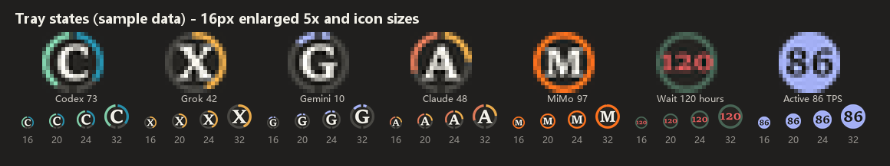

# CodexQuotaTray · AI 额度与 TPS 托盘

面向 Windows 的独立托盘工具，将本机 AI 客户端的账号额度、生成速率、重置时间和用量趋势放到通知区域。启动时先显示缓存，再在后台读取各来源；鼠标悬停后展开置顶任务面板。

A Windows system-tray monitor for local AI quota and token-usage signals, with generation-rate indicators, reset countdowns and topmost detail cards.

[MIT 许可证](LICENSE) · [快速开始](#安装与启动) · [数据源](#数据源与支持范围) · [配置](#配置) · [构建](#构建-exe) · [自检](#自检与排错)

## 功能概览

- **独立来源图标**：默认显示 Codex、Grok、Gemini，Claude Code 为可选来源。
- **额度圆环**：外圈表示剩余百分比。存在两个额度窗口时，按剩余更少的窗口绘制图标，任务面板分别展示各窗口。
- **生成速率显示**：取得可核验样本且来源处于活动状态时，圆盘点亮并显示最近样本；缺少样本时继续显示额度。
- **Agent 任务气泡**：悬停任一额度图标都会打开任务面板（没有任务时也显示）：顶部保留 5 小时、每周额度与 TPS，下方每个气泡是一项任务及其当前动作；把气泡拖到一起即告诉程序它们是同一任务的并行部分，合并为大气泡并重新识别。
- **按需刷新**：根据空闲、活动、生成结束、读取失败和重置时间调度额度查询。
- **额度耗尽预测**：从本程序积累的数值历史估计消耗趋势，样本不足时明确提示。
- **缓存与诊断**：失败时保留最后有效数值并标记旧数据，运行日志自动轮转。

### 图标与面板示例

以下图片由项目自身的绘制代码生成，使用演示数据，不代表真实账号额度、实测速率或当前运行状态。图标依次展示 C、G、M、A；A 为可选的 Claude Code 来源。




## 数据源与支持范围

| 图标 | 来源 | 额度读取方式 | 生成速率与输出计数 | 当前边界 |
| --- | --- | --- | --- | --- |
| C | GPT / Codex | 本机 Codex App Server 的 `account/rateLimits/read` | 本地会话的真实输出 token 计数，以及关联的客户端流式时间 | 按账号响应展示一个或两个额度窗口；统计依赖本地日志格式 |
| G | Grok CLI | 临时 CLI 会话执行 `/usage`，解析 `Weekly limit` 与重置时间 | 直接读取客户端原生 `tokens_per_sec` 和输出计数 | 需要对应 CLI 已安装、已登录；终端输出格式变化会影响解析 |
| M | Gemini / Antigravity | `agy --print /usage --output-format json`，读取全部额度池（Argon、Claude/GPT、Gemini），圆环优先显示 Argon，其次 Claude/GPT，最后 Gemini | 读取 Antigravity 桌面端或 CLI 本地记录中的输出计数，按模型回复步骤的创建至完成时间计算 TPS（含首字延迟） | 客户端不提供原生 TPS；`agy` 不能直接替换成任意名为 Gemini 的 CLI |
| A | Claude Code，可选 | 临时 Claude Code 会话执行 `/usage`，解析当前会话与每周订阅窗口 | 读取本地会话的 `message.usage.output_tokens` | 解析、去重与错误路径已有测试；真实订阅账号额度尚缺端到端验收；免费桌面端额度未接入 |
| X | Xiaomi MiMo Token Plan，可选 | 控制台 `/api/v1/tokenPlan/usage`、`/detail`（需登录一次）；或手动 `mimo.json` | 读取 Codex / Claude Code / MiMo Code 本地记录中 `mimo-*` 模型的输入、缓存与输出 token，按价格表换算 Credits | 控制台接口非公开，返回格式依据前端推断，尚缺真实账号验收 |

额度、输出计数和生成速率来自不同信号。能读到额度，不代表同一来源也提供生成 TPS；没有近期记录也不能证明没有使用。

### Claude Code 与 Claude 桌面端

A 来源面向 **Claude Code 的 CLI 和本地会话记录**。Claude 桌面应用的安装状态、免费版聊天额度和桌面端对话记录不通过这条接口读取。

Claude 默认关闭，不会因安装客户端而开始读取。开通订阅并登录 Claude Code 后，右键任意托盘图标，勾选 **Claude 额度检测（订阅开通后启用）**；托盘自动重启、执行首次读取，随后定期刷新。取消勾选会停止读取并隐藏 A，选择会保存。免费桌面端和 API Key 计费环境没有这类订阅额度窗口。

显式设置 `CODEX_QUOTA_PROVIDERS` 含 `claude` 也可首次启用；托盘菜单保存的启停选择优先。读取前先检查非交互登录状态，无登录或无订阅时暂停 12 小时；订阅读取在独立进程中执行，含终端初始化的总超时为 45 秒，避免卡住其他来源。

### Xiaomi MiMo Token Plan

Token Plan 按 Credits 计费，本程序统一按**年度**一个额度池计算（周期为套餐到期日前的一年；控制台若有按月的账期不单独显示），没有 5 小时/每周窗口。X 图标（小米橙）的外环显示**年度额度**剩余比例；环上的象牙色刻度是“按时间平均使用时应剩的位置”，外环短于刻度说明用得偏快。任务面板顶部显示套餐剩余；右键“额度详情”列出年度额度（附“时间已过 x%”）、剩余 Credits / 已用 Credits / 今日已用 / 日均消耗、到期日、本机今日各来源用量，并按“整期平均”和“最近 7 天本机日均”中较快者预测是否会提前用完。

数据来源（按优先级）：

1. **控制台（精确，包含所有设备）**：只读 `platform.xiaomimimo.com` 套餐页使用的 `GET /api/v1/tokenPlan/usage` 与 `/api/v1/tokenPlan/detail`。右键 X 图标选“登录小米 MiMo…”（或运行 `CodexQuotaTray.exe --mimo-login`），会在应用自有的 Edge/Chrome 配置 `mimo-edge-profile` 中打开控制台窗口；登录后程序在控制台页面内读取套餐（与网页本身的登录方式无关），成功后窗口自动关闭并弹出结果。程序只保留 `platform.xiaomimimo.com` 的 cookie 和控制台接口请求自带的令牌请求头（如有），用 Windows DPAPI（当前用户）加密为 `mimo-session.bin`，不接触小米账号密码或 `account.xiaomi.com` 的 cookie；之后直接读取接口；被拒绝（过期或需要更多凭据）时用同一配置无窗口地在页面内读取一次并更新会话，仍失败才提示重新登录（6 小时内不重复尝试）。“退出 MiMo 登录”删除保存的会话。
2. **本机记录（实时，仅本机）**：把 Codex、Claude Code、MiMo Code（`mimocode.db`）中 `mimo-*` 请求的缓存命中 / 未命中输入和输出 token 按官方价格表换算为 Credits（v2.6-pro / v2.5-pro：2.5 / 300 / 600；v2.6-flash / v2.5：2 / 100 / 200；北京时间 0:00–8:00 ×0.8；未收录型号按 pro 估算并注明），记入 `mimo-ledger.json`。两次控制台读取之间，显示值 = 最近一次控制台“已用” + 本机此后增量，下次读取时校准。
3. **手动配置（不登录）**：`%LOCALAPPDATA%\CodexQuotaTray\mimo.json` 写入 `{"total_credits": 49200000000, "period_end": "2027-06-01"}`，可选 `period_start`、`used_credits`、`used_at`、`plan_name`（未给 `period_start` 时按到期日前一年计算）；用量只来自本机记录。

Claude Code 通过 `ANTHROPIC_BASE_URL`（环境变量或 `~/.claude/settings.json`）指向 `xiaomimimo.com` 时没有 Claude 订阅可读，A 不会自动出现，这些会话计入 X。未显式指定来源时，X 在已登录/已配置 MiMo、Codex `config.toml` 或 Claude Code 指向 `xiaomimimo.com`、或存在 MiMo Code 数据目录时自动加入。程序不会用 Token Plan 的 API Key 发请求探测额度（套餐只允许在编程工具中使用，探测也会消耗 Credits）。

## 安装与启动

### 运行环境

- Windows 10/11 的交互式桌面，推荐 64 位 Python 3.12。
- 本机验收环境为 Windows 11、Python 3.12.10。Windows 10 尚缺本项目的实机验收记录。
- 对应来源的客户端及登录状态。可先只启用已准备好的来源。

托盘界面依赖 Win32 与 Windows 通知区域。Linux 上可运行部分纯逻辑模块，完整托盘程序的运行目标是 Windows。

### 从源码运行

```powershell
git clone https://github.com/ANTiqiuSama/CodexQuotaTray.git
Set-Location CodexQuotaTray
python -m venv .venv
.\.venv\Scripts\python.exe -m pip install -r requirements.txt

# 固定显示来源，也适合只使用 Claude 免费桌面端的情况。
$env:CODEX_QUOTA_PROVIDERS = 'codex,grok,gemini'
.\.venv\Scripts\python.exe -X utf8 tray_app.py
```

仓库提供源码与构建入口。自行构建的程序位于指定输出目录，可直接运行 `CodexQuotaTray.exe`。正常托盘实例使用单实例锁，重复启动不会增加一套图标。

### 日常操作

| 操作或状态 | 行为 |
| --- | --- |
| 鼠标在图标上短暂停留 | 打开任务气泡面板（额度、TPS、agent 气泡与定时任务；没有任务时也显示） |
| 拖动气泡叠到另一个气泡上松开 | 标记为同一任务，合并为大气泡并重新识别 |
| 右键合并后的大气泡 | 拆回独立气泡 |
| 移开鼠标 | 关闭详情，图标恢复最新数值 |
| 左键点击图标 | 打开对应桌面程序或 CLI |
| 右键 → 立即刷新 | 请求所有已显示来源刷新额度 |
| 右键 → 额度详情 | 显示文字详情与预测 |
| 右键 → 本机全部 AI 速率 | 查看各来源输出速率及软件检测结果 |
| 右键 → 打开诊断信息 | 生成并打开本地诊断文件 |
| 右键 → 开机自启 | 切换当前程序的 Windows 登录启动项 |
| 右键 → 退出全部 | 退出所有来源图标 |

空闲时是深色圆盘与字母，生成时是来源主色的亮圆盘与 TPS 数字。字母、数字优先使用 Sitka Small Bold，并回退到 Cambria、Palatino、Georgia 等系统字体。低于 50% 为琥珀色，低于 20% 为玫瑰红；未知值显示 `?`，旧数据增加琥珀色圆点。

悬停期间暂缓重绘对应托盘图标，面板内容继续更新，移开后再补上图标数值。面板无法显示时回退为原生文字提示。

## 指标如何计算

### 生成 TPS

**Grok** 直接采用客户端提供的原生 TPS 数值。

**Codex** 从本地日志复算最近完成请求的生成速率：

```text
生成 TPS = 真实输出 token 数 / 首个输出项开始至最后一个输出项完成的流式时间
```

结束时间取客户端日志中最后一个输出项完成的时刻；缺少该日志时退回计数记录的写入时间。少于 16 个 token 或不足 0.3 秒的回复不计算。输出计数可包含思考及工具调用输出。它按完成时取得的计数结算，不使用字符长度、近似分词器或请求整体耗时代替。

所有带流式时长的来源（Codex、MiMo、Gemini），显示值是最近 90 秒内同一来源各次回复按 token 加权的速率（输出 token 总数 ÷ 流式时间总和），避免短小的工具调用回复让数字大幅跳动；只有一次回复时即为该次的值。该值属于最近完成的样本，不是逐 token 更新的服务端瞬时速度。样本超过 5 分钟后失效；缺少完整样本时保留额度显示。一次生成结束后，活动状态约保留 3 秒。

**Xiaomi MiMo** 按调用它的客户端分别取值，详情中注明依据：

| 客户端 | 计算方式 | 说明 |
| --- | --- | --- |
| MiMo Code | 真实输出 token 数（含思考）÷ 该消息首个输出开始至最后输出结束（思考/文本片段的 `time.start/end`，工具调用以参数流结束为止） | 不含首字延迟和工具执行时间；最接近生成 TPS。生成中的消息会点亮 X 图标 |
| Codex（模型提供方指向 MiMo） | 与 Codex 相同：真实输出 token 数 ÷ 首个输出项至计数完成的流式时间 | 客户端直连 MiMo 接口，流式时间可用 |
| Claude Code（`ANTHROPIC_BASE_URL` 指向 MiMo） | 真实输出 token 数 ÷ 请求发出（上一条用户/工具结果记录）至回复结束 | 记录中没有流式时间，只能算**端到端速率**，包含首字延迟，数值偏低；标注“含首字延迟” |

**Gemini / Antigravity** 从本地会话数据库（`~/.gemini/antigravity*/conversations/*.db`）读取每次生成的输出 token（正文 + 思考），用对应模型回复步骤（step_type 15）从创建到完成的时间计算：

```text
Gemini TPS = 输出 token 数 / 回复步骤创建至完成的时间（含首字延迟）
```

数据库被 Antigravity 锁定时读取其临时副本。

Antigravity 有多个独立额度池。程序把 `/usage` 中的桶按模型家族归类（名称含 argon → Argon；claude / gpt → Claude/GPT；gemini → Gemini），每个池取剩余最少的窗口。M 图标圆环、排序、预测与通知跟随优先级最高的池（Argon > Claude/GPT > Gemini）；任务面板顶部并列显示各池剩余与重置时间，右键“额度详情”逐行列出。

Gemini 气泡的任务名来自会话数据库中用户消息步骤（step_type 14）的文字，桌面端还会读取 `~/.gemini/antigravity/brain/<会话>/task.md` 的标题；若客户端版本的步骤编号不同，可用 `CODEX_QUOTA_AGY_USER_STEPS=14,…` 指定。`--check-gemini-tps` 的 `user_steps`、`step_columns` 只报告字数与列名，便于核对。经 Codex 桥接使用 Gemini 时，同样采用 Codex 客户端的流式统计。

**Claude 模型的 Claude Code** 当前没有可核验的原生生成 TPS，界面保留未知值，只展示可读到的输出计数和活动状态。

### 最近 60 秒输出速率

```text
60 秒输出速率 = 窗口内已报告的输出 token 总数 / 60
```

这是窗口平均吞吐，不能直接当作单个请求的生成 TPS。统计不计输入和缓存 token，也不重复加入已包含在输出总数中的思考 token。

同一 Claude Code 消息的分块记录按消息 ID 合并计数，完成、出现后续消息或静默达到阈值后结算。现有 Codex Gemini 桥接路径做一对一去重。未知模型可能归入“其他模型”，不保证每种第三方桥接记录都能自动识别。

TPS 观察器每秒读取已有本地信号，本身不发送模型生成请求。额度查询会启动对应 CLI 或 App Server，并由客户端处理网络访问和登录状态。

## 刷新与缓存

额度查询由 `refresh_scheduler.py` 调度，TPS 观察独立运行。

| 触发条件 | Codex | Gemini | Grok | Claude Code |
| --- | --- | --- | --- | --- |
| 启动、手动刷新、检测到唤醒时钟跳变 | 尽快刷新 | 尽快刷新 | 尽快刷新 | 尽快刷新 |
| 空闲 | 5 分钟 | 5 分钟 | 30 分钟 | 30 分钟 |
| 持续活动 | 1 分钟 | 2 分钟 | 10 分钟 | 10 分钟 |
| 一次生成结束 | 5 秒后 | 8 秒后 | 20 秒后 | 20 秒后 |
| 额度用尽，距重置较远 | 照常（可能提前重置） | 照常 | 最长 3 小时一次 | 照常 |
| 额度用尽，重置前 30 分钟内 | 每 3 分钟 | 每 3 分钟 | 每 3 分钟 | 每 3 分钟 |
| 额度用尽，重置前 5 分钟至重置后 10 分钟 | 每 1 分钟 | 每 1 分钟 | 每 1 分钟 | 每 1 分钟 |
| 已过重置时间但仍显示用尽（服务端或 CLI 滞后） | 1 小时内每 3 分钟，之后按空闲间隔 | 同左 | 同左 | 同左 |
| 额度用尽但重置时间未知或不可信 | 照常 | 照常 | 按空闲间隔（30 分钟），不再长时间等待 | 照常 |
| 读取失败 | 30 秒、1 分钟、2 分钟、5 分钟退避 | 同左 | 同左 | 连续失败 3 次后每 12 小时 |
| 账号没有该额度（如无 Claude 订阅） | — | — | — | 每 12 小时，且不再因使用而刷新 |
| 已知额度重置时间 | 重置后约 5 秒 | 同左 | 同左 | 同左 |

CLI 显示的重置时间不带年份（如 `Next reset: September 28, 11:53`）。刚过去几天内的日期按“刚发生的重置”处理，不再被误判为明年。

手动“立即刷新”总是立即读取。未订阅 Claude 时也可以用 `CODEX_QUOTA_PROVIDERS` 去掉 Claude 图标。

Codex、Grok、Claude 的额度窗口恢复（剩余回升至少 10 个百分点）时会弹出 Windows 通知，例如“Grok 额度已重置：每周窗口 0% → 100%”；早于原定重置时间时注明“提前重置”。可用 `CODEX_QUOTA_RESET_NOTIFY` 调整来源列表。

Codex 每次响应后会把服务端返回的额度写入本地会话记录（`token_count` 事件中的 `rate_limits`）。托盘每秒读取这些记录，比上次 App Server 读取更新时立即更新 C 图标，无需等到下一次定时刷新；会话记录出现“usage limit / rate limit”错误时，约 3 秒后立即重新读取 App Server。

调度按来源管理，同一轮到期的读取并行执行。CLI 启动、网络和已有读取任务会影响实际完成时间。右键“额度详情”显示下一次计划刷新。

Grok 的 `/usage` 在每次新建的独立进程中读取，包含隐藏终端初始化的总超时为 35 秒；超时只结束该临时进程及其子进程，保留上次有效额度并退避重试，避免阻塞其他来源。`--check-grok work/checks/grok.json --raw` 还会保存 `grok.raw.json`，仅含 CLI 的 `Weekly limit` 和 `Next reset` 原文，方便核对日期与时区。

查询失败时继续显示最后有效数值，同时保留原更新时间并标记“旧数据”。`performance.json` 只在内容变化或距上次保存达到 60 秒时写入；文件时间没有逐秒变化，并不直接意味着观察器停止。

## 额度耗尽预测

每次成功刷新后，程序记录时间、已用百分比与重置时间。它优先选择当前重置窗口内最近 3 小时的样本；近期样本不足时回退到该窗口的完整历史。至少需要两个读数，且时间跨度达到 10 分钟。

程序对已用百分比与时间做最小二乘直线拟合，估计每小时消耗的额度百分点：

```text
预计耗尽所需秒数 = 剩余百分比 / 每小时消耗百分点 × 3600
```

例如，若示例账号一小时内从已用 20% 升到 30%，线性估计为每小时消耗 10 个百分点。剩余 70% 对应约 7 小时。这只是说明计算方式的假设数据。

当预计耗尽时间早于重置，右键“额度详情”提示约多久后用完；足以覆盖到重置时提示预计剩余量。额度回升或重置窗口变化时，旧窗口样本被截断或排除。历史按窗口最多保留 400 个样本，清理超过 8 天的记录。

预测依赖近期使用节奏、离散的百分比读数和客户端提供的窗口信息。样本不足时不生成耗尽估计；它不能预见后续使用强度或服务端规则变化。

## Codex 全局重置预测

OpenAI 的 Codex 团队有时会提前重置所有用户的 Codex 用量（通常由 @thsottiaux 在 X 上宣布）。社区追踪站点会据此给出未来 24 / 48 小时内发生全局重置的概率。托盘按顺序读取以下公开、无需密钥的接口，取第一个可用的结果：

| 顺序 | 来源 | 接口 |
| --- | --- | --- |
| 1 | willreset.com | `GET /api/notify`（约 0.3 KB，官方文档列出的提醒用接口） |
| 2 | codex-reset.com | `GET /api/forecast` |
| 3 | willcodexreset.com | `GET /api/reset-radar`（约 1 MB，仅作后备） |

- 每 30 分钟读取一次；概率较高时改为每 10 分钟。结果缓存在 `codex_reset.json`。
- 24 小时概率达到阈值（默认 60%）时：C 图标左上角出现天蓝色圆点，悬停提示首行与任务面板顶部显示蓝色提示条，并弹出一次系统通知；Codex 剩余不足 30% 时，提示中会建议等重置后再大量使用。
- 社区确认新的全局重置后，弹出通知并立即重新读取 Codex 额度。
- 右键“额度详情”显示来源、24 / 48 小时概率、上次全局重置时间和 @thsottiaux 最新信号；右键 C 图标的“全局重置预测”可打开来源网站。

这些是社区估计，不是 OpenAI 的官方时间表。请求只发送普通 HTTP GET，不包含任何账户信息。

## Agent 任务气泡

悬停任一额度图标都会打开任务面板（旧的详情卡片已移除）；没有在工作的 agent 时也照常显示。未开通订阅的 Claude 没有额度可显示，仍用文字提示。指针可以移入面板操作，移出约半秒后收起；面板不抢键盘焦点。

| 区域 | 内容 |
| --- | --- |
| 顶部 | 5 小时、每周剩余额度（条下为重置时间）与最近 TPS，打开时数字与额度条从零滚动到当前值；右上角为状态（N 个在工作 / 空闲 / 旧数据 / 读取失败），工作时标题圆点有声呐波纹；MiMo 显示套餐剩余额度；Codex 全局重置概率高时显示蓝色提示条 |
| 气泡内 | 任务名：最近一次实质请求（“继续”“好的”之类不覆盖任务），缺失时用客户端线程标题或项目文件夹 |
| 气泡下 | 当前动作：运行测试、编辑某文件、检索代码、查资料、派发子任务、思考中等；悬停气泡时展开完整任务描述 |
| 定时任务行 | 见下文“定时任务”，不生成气泡 |
| 外圈 | 颜色对应模型来源；呼吸波纹表示正在生成，暗淡表示 3 分钟内刚完成；大气泡上的小圆点是各并行成员 |

所有来源的 agent 都会出现在同一面板，被悬停来源的气泡排在前面并高亮。气泡分组规则：

- **自动**：客户端自己派生的子 agent 归入父任务——Codex `spawn_agent` 子线程（`parent_thread_id`）、Claude Code `subagents/`、MiMo Code 子会话（`parent_id`）。
- **手动**：拖动气泡叠到另一个上，目标亮起光环、被拖的气泡被轻轻吸过去，松开即合并（面板上不再显示操作说明）；分组按会话 ID 保存，重启后仍生效。右键大气泡拆开，拆开后也不再自动归组。
- **重新识别**：合并后先按本地规则命名（有父任务时用父任务的请求，否则选与其他成员最相近的请求），气泡下显示“N 路并行 · 各自分工”。

### 定时任务

定时任务（Codex 自动化、Claude Code 计划任务等）不进入气泡，而在面板底部单列一行标签：

- **运行中**：来源主色标签、呼吸圆点；该次运行结束后立即消失，不作为“刚完成”的气泡停留。
- **未运行**：灰色标签，显示“下次 HH:MM”或“上次 HH:MM”，都没有时为“待运行”。

识别依据（尽力而为，客户端版本不同可能需要校准）：Codex 状态库中名称含 `automation` 的表与 `~/.codex/automations/` 下的定义、Claude `~/.claude/scheduled-tasks/*/SKILL.md`；会话元数据（originator、source、entrypoint）中的 automation / schedule / cron / heartbeat / 定时 标记；7 天内同一请求以 30 分钟以上间隔重复出现。`--check-agents` 输出中的 `schedules`、`schedule_chips` 与各 agent 的 `origin`、`schedule` 字段可用于核对。

### 可选：轻量模型命名

小米 MiMo / Token Plan 可使用控制台对应的 Base URL 和 `mimo-v2.6-flash`。程序会自动使用 `api-key` 认证、关闭深度思考并限制命名输出长度；密钥只保存在本机配置或环境变量中。气泡的当前动作始终优先显示本机最新工具状态，不会被较早的模型摘要覆盖。

默认完全本地，不发送任何内容。若希望标题更精炼，可配置任意 OpenAI 兼容的 Chat Completions 接口（如 MiMo、DeepSeek、本地 Ollama 等的小模型）：

```powershell
$env:CODEX_QUOTA_SUMMARY_URL = 'https://api.example.com/v1'   # 或完整的 /chat/completions 地址
$env:CODEX_QUOTA_SUMMARY_KEY = 'sk-...'
$env:CODEX_QUOTA_SUMMARY_MODEL = 'small-model-name'
```

也可以写入 `%LOCALAPPDATA%\CodexQuotaTray\agent_summary.json`：`{"url": "...", "key": "...", "model": "..."}`。启用后，每个气泡在其请求变化时才发起一次后台请求（结果按输入缓存，失败后 5 分钟内不再请求），合并的大气泡会请求一个总任务名和每个成员的分工；识别期间气泡外圈显示旋转弧线。发送的内容仅为每个成员最近一次请求的前 400 字、项目文件夹名和当前动作。

## 配置

### 选择来源

只对当前 PowerShell 会话设置：

```powershell
$env:CODEX_QUOTA_PROVIDERS = 'codex,grok,gemini'
```

保存为当前 Windows 用户的设置：

```powershell
[Environment]::SetEnvironmentVariable('CODEX_QUOTA_PROVIDERS', 'codex,grok,gemini', 'User')
```

环境变量在程序启动时读取。退出旧托盘后，从包含新变量的终端或登录环境重新启动。恢复自动检测时，清除 `CODEX_QUOTA_PROVIDERS`；未设置该变量时，默认 C/G/M，并按检测结果加入 MiMo。Claude 等待手动启用。

### 图标自动排序

托盘图标按“额度恢复时间”从近到远自左向右排列：每个来源取当前限制使用的那个窗口（剩余更少的窗口）的重置时间；MiMo 按年度额度的到期时间；重置时间未知的排在其后，**已用完的排在最后**。重置时间变化或额度用完/恢复时自动重排；两次重排至少间隔 1 分钟，鼠标停在图标上或任务面板打开时不重排。

Windows 没有移动通知区域图标的接口，而且删除后重新添加的图标会被资源管理器放回它记住的位置，因此程序**不移动图标**：五个托盘图标位置固定，程序读取它们在屏幕上的实际位置，再把各来源按顺序分配给这些图标（图标图像、悬停面板、右键菜单、左键动作一起切换）。所以无论系统的插入方向如何、手动拖动过与否，都按屏幕上从左到右的顺序显示；隐藏在溢出区的图标排在最后，正好放已用完的来源。`CODEX_QUOTA_TRAY_ORDER=fixed` 关闭自动排序。

### 配置项对照

| 变量 | 用途 |
| --- | --- |
| `CODEX_QUOTA_PROVIDERS` | 显示的来源键，支持 `codex,grok,gemini,claude,mimo`；按注册表顺序显示 |
| `CODEX_QUOTA_CODEX_EXE` | 用于额度查询的 `codex` App Server 可执行文件路径 |
| `CODEX_QUOTA_RESET_NOTIFY` | 额度重置时弹出 Windows 通知的来源，默认 `codex,grok,claude`；设为 `none` 关闭 |
| `CODEX_QUOTA_RESET_WATCH` | 设为 `0` 关闭 Codex 全局重置预测（不再访问社区站点） |
| `CODEX_QUOTA_RESET_ALERT` | 醒目提示的 24 小时概率阈值，默认 `60`（百分比） |
| `CODEX_QUOTA_GROK_EXE` | 用于额度查询的 Grok CLI 路径 |
| `CODEX_QUOTA_GEMINI_EXE` | 提供对应 `/usage` JSON 的 `agy` 可执行文件路径 |
| `CODEX_QUOTA_CLAUDE_EXE` | Claude Code 的 `.exe` 或 npm `.cmd` 入口路径 |
| `CODEX_HOME` | Codex 本地日志与会话数据根目录 |
| `GROK_HOME` | Grok 本地记录根目录 |
| `CLAUDE_CONFIG_DIR` | Claude Code 数据根目录，默认 `~/.claude` |
| `CODEX_QUOTA_TRAY_ORDER` | 图标排序：`auto`（默认，恢复时间近的在左，用完的在最后）、`fixed`（固定顺序） |
| `CODEX_QUOTA_MIMO_BROWSER` | MiMo 登录窗口使用的 Edge/Chrome 路径 |
| `CODEX_QUOTA_MIMO_PLATFORM` | MiMo 控制台地址，默认 `https://platform.xiaomimimo.com`（测试用） |
| `CODEX_QUOTA_SUMMARY_URL` / `_KEY` / `_MODEL` | 可选的 OpenAI 兼容接口，用于把 agent 请求归纳为气泡标题；未设置时只用本地规则 |
| `CODEX_QUOTA_LEGACY_DPI=1` | 关闭悬停线程的 Per-Monitor V2 模式，供旧显示环境排错 |

路径应指向实际安装位置，例如：

```powershell
$env:CODEX_QUOTA_CLAUDE_EXE = 'C:\Tools\ClaudeCode\claude.cmd'
$env:CODEX_QUOTA_PROVIDERS = 'codex,grok,gemini,claude'
```

读取器路径覆盖与左键启动入口是两项设置。左键启动方式由 `providers.py` 中的 `ProviderSpec.launch` 决定；安装方式不同时，需要调整对应入口。

Claude 额度探测在本程序的 `claude-probe` 文件夹中执行，仅发送 `/usage` 状态指令，并使用 `--strict-mcp-config`。首次出现该文件夹的信任提示时，读取器会自动确认。CLI 仍可能使用或更新其自身的偏好、信任和会话文件；这不是对任意工作目录的通用授权。

## 本地数据与隐私

程序自身的数据目录为 `%LOCALAPPDATA%\CodexQuotaTray`：

| 文件或目录 | 内容 |
| --- | --- |
| `state.json` | 最后一次额度读数、时间、旧数据标记和错误状态 |
| `performance.json` | 数值化输出计数、速率、来源及可观测状态 |
| `history.json` | 预测用的时间、已用百分比、重置时间 |
| `codex_reset.json` | 最近一次 Codex 全局重置预测 |
| `app.log` | 运行日志（错误与每次额度刷新结果），达到约 1 MB 后轮转，保留两份备份 |
| `diagnostics.txt` | 从菜单生成的诊断信息 |
| `claude-probe/` | Claude Code 临时额度探测的工作目录 |
| `mimo-session.bin` | MiMo 控制台 cookie（仅 platform 域，DPAPI 加密） |
| `mimo-edge-profile/` | MiMo 登录用的应用自有浏览器配置 |
| `mimo-ledger.json`、`mimo-days.json` | 本机 MiMo Credits 账本（40 天）与每日首次控制台读数 |
| `mimo.json` | 可选的 MiMo 手动套餐配置 |
| `agent_groups.json` | 手动合并的任务分组与拆开记录（仅会话 ID，7 天未用自动清理） |
| `agent_summary.json` | 可选的气泡命名接口配置 |
| `mimo-login.log` | MiMo 登录/续期诊断：步骤、HTTP 状态码、cookie 与请求头的**名称**（不含值） |

TPS 读取器会在内存解析本地会话记录。任务气泡所需的请求摘要、工具名和线程标题同样只在内存中，不写入任何文件；只有配置了命名接口时，才会把上节所述的截断请求发往该接口。`performance.json` 保存数值投影、模型名等统计字段，不包含已解析的消息正文。程序不直接打开客户端的 `auth.json` 或提取 token、cookie；登录由已有客户端处理。唯一例外是 MiMo：控制台会话 cookie 由程序自己的登录窗口取得，并加密保存在上表位置。

日志与诊断可能包含本地路径、错误文本、账户用量和软件状态。`--check-claude --raw` 额外保存终端文本，仅自动遮盖邮箱，其他内容仍需在共享前检查。仓库的 `.gitignore` 排除了运行缓存、日志、构建输出和常见本地凭据文件。

## 构建 EXE

在已安装依赖的 Python 环境中运行：

```powershell
# build.ps1 使用 PATH 中的 python；虚拟环境用户先在当前终端调整 PATH。
$env:Path = (Join-Path $PWD '.venv\Scripts') + ';' + $env:Path
.\build.ps1 -DistPath .\outputs
```

脚本先运行测试，再生成单文件、无控制台的 `outputs\CodexQuotaTray.exe`。不指定 `-DistPath` 时，默认将 EXE 放在仓库父目录，沿用本机维护部署约定。

**维护脚本会将构建时仓库父目录下的 `runtime-temp` 写入 EXE，作为依赖解包位置。** 这适合固定位置的本机部署。若要把 EXE 分发到其他电脑，可使用默认系统临时目录进行构建：

```powershell
python -m PyInstaller --noconfirm --onefile --windowed `
  --collect-binaries winpty --collect-data winpty --collect-data tzdata `
  --name CodexQuotaTray --distpath outputs `
  --workpath work/pyinstaller --specpath work tray_app.py
```

替换正在使用的 EXE 前，从任意图标的菜单选择“退出全部”。Windows 字体从本机系统目录加载，不随仓库分发；打包依赖仍适用各自的许可证。

## 自检与排错

先正常运行一次程序，等待本地缓存生成，再使用诊断入口。以下命令以自行构建的 EXE 为例：

```powershell
New-Item -ItemType Directory -Path work/checks -Force | Out-Null
.\outputs\CodexQuotaTray.exe --check-tps work/checks/tps.json
.\outputs\CodexQuotaTray.exe --check-codex work/checks/codex.json
.\outputs\CodexQuotaTray.exe --check-gemini-tps work/checks/gemini-tps.json
.\outputs\CodexQuotaTray.exe --check-reset work/checks/reset.json
.\outputs\CodexQuotaTray.exe --check-grok work/checks/grok.json
.\outputs\CodexQuotaTray.exe --check-claude work/checks/claude.json
.\outputs\CodexQuotaTray.exe --check-mimo work/checks/mimo.json
.\outputs\CodexQuotaTray.exe --check-hover work/checks/hover.json
.\outputs\CodexQuotaTray.exe --check-agents work/checks/agents.json   # 另存 agents.png 面板预览
```

`--check-tps` 读取两次本地统计；`--check-reset` 读取全局重置预测，并列出各来源的错误；`--check-gemini-tps` 输出最新几个 Antigravity 数据库的结构（字段编号、数值、时间，不含提示词和回复文本）以及当前 Gemini TPS；`--check-codex` 读取 App Server 额度，加 `--raw` 时另存 `codex.raw.json`，包含 App Server 原始响应、最近一条会话记录中的 `rate_limits` 和额度用尽错误时间；`--check-grok`、`--check-claude`、`--check-mimo` 检查对应真实额度链路。每次定时刷新的结果（剩余、重置时间、是否旧数据、错误）都会写入 `app.log`，便于排查图标未更新。额度读取失败时返回非零退出码，并保留结果中的错误说明。

`--check-hover` 会短暂显示约 4 秒的置顶全屏测试窗口，验证任务面板置顶、覆盖全屏窗口、位于工作区内、持续刷新不闪烁与焦点保持，随后自动关闭。它不移动真实鼠标。

需要核对 Claude CLI 新版本的界面格式时，可显式使用：

```powershell
.\outputs\CodexQuotaTray.exe --check-claude work/checks/claude.json --raw
```

| 现象 | 检查方向 |
| --- | --- |
| 没看到图标 | 检查 Windows 隐藏图标区域、来源选择和 `app.log` |
| 只显示字母或 `?` | 查看详情中的额度状态；确认客户端入口和登录已准备好 |
| Codex 额度用完但图标没变 | 查看 `app.log` 中的 `quota codex` 与 `codex quota from session record` 行；用 `--check-codex <文件> --raw` 核对 App Server 各额度桶与会话记录 |
| Gemini 没有 TPS | 运行 `--check-gemini-tps <文件>`，查看数据库是否被找到、是否读取出错、回复步骤是否有创建/完成时间 |
| 生成时没有 TPS | 查看是否取得完整样本，以及该来源是否提供生成 TPS |
| Gemini 查询超时 | 检查 `agy` 的登录、网络和 `/usage` 输出，旧数值会保留并标记 |
| Claude 没有显示 | 开通订阅并登录 Claude Code 后，在托盘菜单勾选“Claude 额度检测（订阅开通后启用）” |
| Claude 有图标却没有额度 | 检查 Claude Code 的登录与订阅窗口；免费桌面端不通过该读取器接入 |
| X 显示“未登录”或登录窗口不关闭 | 右键 X 选“登录小米 MiMo…”，或运行 `--mimo-login`，登录后停留在控制台页面；仍不成功时查看 `mimo-login.log`；用 `--check-mimo <文件> --raw` 保存去除身份字段的接口原文以核对格式 |
| 任务面板在全屏应用中没有出现 | 先让任务栏图标可见；独占全屏和安全桌面尚不保证覆盖 |
| 中文出现方框或显示模糊 | 检查系统中文字体，必要时用 legacy DPI 选项排错 |
| 构建提示 EXE 被占用 | 退出正在运行的目标程序，或构建到另一输出目录 |

## 项目结构与扩展

```text
providers.py          来源注册表、检测、配色、刷新间隔与启动入口
quota_sources.py      额度读取、双窗口解析、缓存与失败保留
cli_usage.py          CLI 临时会话、输出解析与时间处理
tps_sources.py        本地记录发现、输出计数、去重与速率汇总
refresh_scheduler.py  按需刷新、失败退避和重置调度
forecast.py           数值历史与额度耗尽估计
reset_watch.py        Codex 全局重置的社区预测读取与提示文案
icon_art.py           额度与 TPS 圆盘绘制、字体缓存
detail_card.py        面板共用的字体、配色、阴影与合成
hover_details.py      Win32 分层窗口、DPI、悬停、任务面板窗口及文字提示回退
agent_tasks.py        各 agent 在做什么：请求/动作提取、自动与手动分组、可选模型命名
agent_panel.py        任务气泡面板：布局、弹簧动画、拖动合并与拆分、Pillow 渲染
hover_check.py        任务面板窗口显示自检
mimo_usage.py         MiMo 控制台读取、登录、Credits 账本与年度节奏
tray_app.py           程序入口、菜单、线程协调与登录启动项
test_*.py             额度、速率、任务面板、定时任务、调度及 Claude 回归用例
demo_assets.py        生成 README 演示图（演示数据）
build.ps1             测试与 PyInstaller 构建入口
```

新增来源时，在 `providers.py` 添加 `ProviderSpec`，在 `quota_sources.py` 实现额度读取并登记到 `_reader()`。若有可核验的本地计数，再为 `tps_sources.py` 增加观察器及去重规则。为新格式增加真实结构的脱敏测试用例，缺失字段应保持未知。

## 测试与验收状态

完整测试命令：

```powershell
python -X utf8 -m unittest -v test_quota_sources.py test_tps_sources.py `
  test_tray_app.py test_features.py test_claude.py test_mimo.py test_reset_watch.py
```

2026-10-16，本机 Windows 11 / Python 3.12.10 对代码版本 `d5a553a`（合入提交 `ea19ed0`）运行 **97 项测试，全部通过**。测试覆盖解析、计数去重、来源注册表、图标、卡片、刷新调度和预测计算；这是一份本机验证记录。

原生卡片另做过置顶全屏窗口测试：79 次连续采样位置稳定，未反复隐藏，键盘焦点保持不变。纯渲染用例覆盖不同缩放比例。Claude Code 的订阅账号真实额度仍缺端到端验收，免费桌面端的额度与 TPS 尚未接入。

尚未覆盖的场景包括 Windows 10 实机、所有显示器缩放组合、独占全屏游戏、各客户端未来版本，以及没有可观测本地记录的软件和独立网页。

## 参与维护

可通过 [Issues](https://github.com/ANTiqiuSama/CodexQuotaTray/issues) 报告问题，或提交 Pull Request。问题说明中提供 Windows、Python、客户端版本，复现步骤及脱敏后的错误字段。修复读取器时优先提供测试样例，说明该字段是原生值、计数还是推导值。

读取方案参考了 [Tokscale](https://github.com/junhoyeo/tokscale)、[Tallyburn](https://github.com/seoulpro/tallyburn)、[Grok Build](https://github.com/xai-org/grok-build) 和 [Codex 遥测说明](https://learn.chatgpt.com/docs/config-file/config-advanced)。本项目使用独立的 Python 读取器。

## 许可证

本项目自有源码与说明采用 [MIT License](LICENSE)，版权归 ANTiqiuSama。依赖库遵循各自的许可证；例如 pystray 的 LGPLv3、PyInstaller 的发行例外等，均不因本项目选择 MIT 而改变。分发打包版本时应保留所用依赖要求的许可材料。
